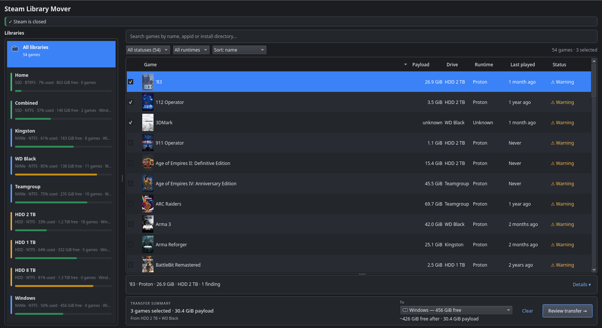
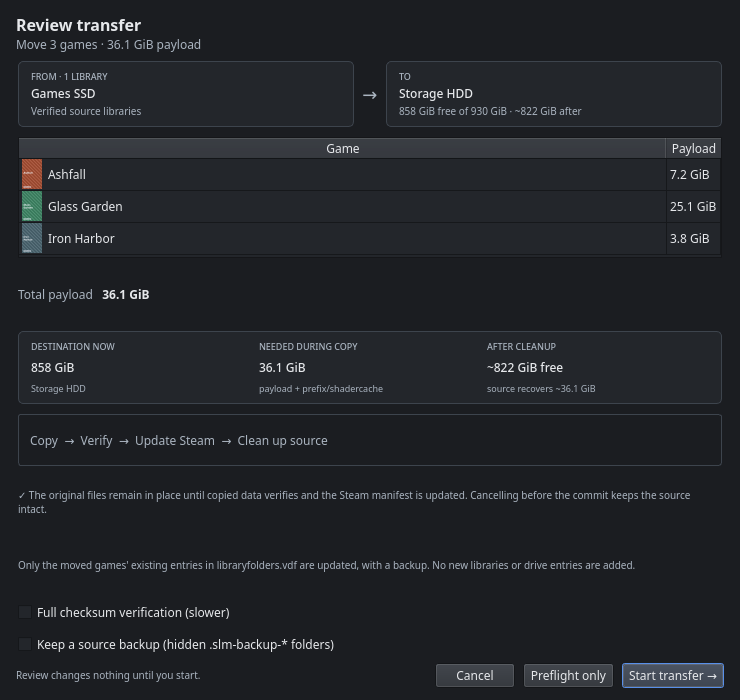
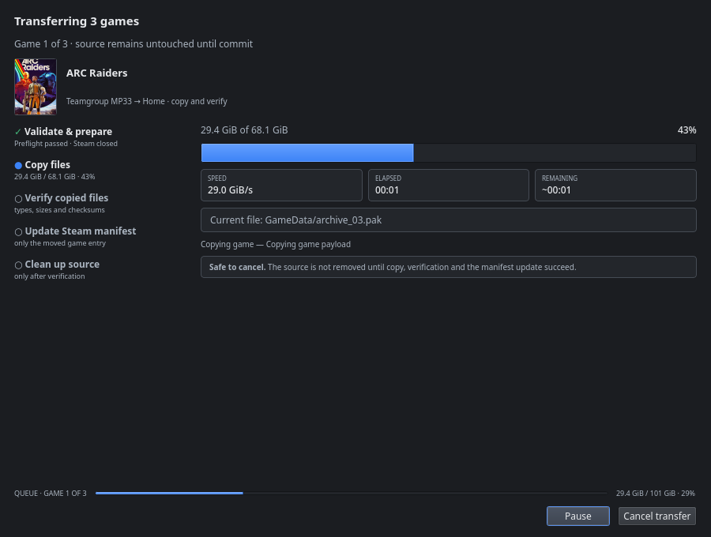

<p align="center">
  
</p>

<h1 align="center">Steam Library Mover</h1>

<p align="center">
  Move installed Steam games between Steam libraries on Linux — without Steam's
  <code>Move install folder</code> operation.
</p>

<p align="center">
  <a href="https://github.com/NasirA1991/steam-library-mover/actions/workflows/ci.yml">
    
  </a>
  <a href="https://github.com/NasirA1991/steam-library-mover/releases">
    
  </a>
  <a href="https://aur.archlinux.org/packages/steam-library-mover">
    
  </a>
  <a href="LICENSE">
    
  </a>
</p>

> **Public alpha — v0.1.0.** This is a safety-sensitive tool. Read
> [docs/SAFETY.md](docs/SAFETY.md) before moving real games, and keep an independent backup of
> irreplaceable data.

## Download

Published artifacts are attached to [GitHub Releases](https://github.com/NasirA1991/steam-library-mover/releases):

| Artifact | Best for |
| --- | --- |
| `Steam_Library_Mover-x86_64.AppImage` | Portable test on most Linux distributions |
| `steam-library-mover-*.pkg.tar.zst` | Arch Linux / CachyOS manual install |
| [AUR `steam-library-mover`](https://aur.archlinux.org/packages/steam-library-mover) | Arch Linux / CachyOS with an AUR helper |
| `steam-library-mover-*.tar.gz` | Building from source |

Arch users can install with:

```bash
yay -S steam-library-mover
# or: paru -S steam-library-mover
```

AUR releases are updated automatically by the tag workflow. A Flatpak bundle is **built by
GitHub Actions as an experimental artifact**, but is not attached to the release: host
Steam/Proton process detection inside the sandbox has not been validated. Do not install that
artifact expecting it to be safe for real moves.

## Screenshots

<p align="center">
  
</p>

<p align="center">
  
  &nbsp;
  
</p>

<p align="center"><sub>Captured from the development build against read-only test libraries; the
warnings and blockers shown are expected. The main screenshot is cropped to remove the local
Steam path.</sub></p>

## Why this exists

On Linux, moving a Proton game between libraries often fails with **“content file locked”** when the
destination library's `steamapps/compatdata` is a symlink pointing back to the prefix's current
location. Steam tries to move the prefix onto itself, hits “Can't overwrite existing file”, and rolls
the whole move back. Native Steam libraries on NTFS hit related issues because Proton creates
filenames that Windows/NTFS cannot represent.

This tool avoids Steam's mover entirely:

1. It requires Steam to be closed.
2. It copies the game, app manifest, Proton prefix, shader cache and Workshop data.
3. It verifies the destination and syncs it to disk.
4. It writes the destination manifest and updates `libraryfolders.vdf` atomically.
5. It removes the source manifest and only then cleans up the source payload.

If anything fails before the source manifest is removed, the source remains usable. Every operation
is journaled under `~/.local/state/steam-library-mover/` and can be inspected or rolled back from the
Recovery dialog.

## Features

- Detects native and Flatpak Steam installations and their registered libraries.
- Lists installed games using local `appmanifest_<appid>.acf` data. **No Steam API key is needed**;
  the appid is already in the manifest.
- Box art is read from Steam's local `librarycache` first; missing portraits are downloaded from
  Steam's public static CDN and cached under `~/.cache/steam-library-mover/artwork`. This can be
  disabled in Settings. No telemetry or Steam credentials are involved.
- Handles shared `compatdata` symlinks by comparing canonical prefix paths and skipping the prefix
  when source and destination resolve to the same directory.
- NTFS/exFAT/FAT32 preflight: invalid Windows filenames, reserved names, case collisions, FAT32 size
  limits and executable-bit caveats.
- Blocks pending updates, active downloads, running Steam/Proton/Wine processes, missing payloads,
  system components, prefix conflicts, duplicate appids and insufficient space.
- Journaled moves with progress, cancellation, verification and recovery.
- Smart filters: Ready, Blocked, Warnings, Proton, Native, Unknown; sort by name, size, recent play,
  or runtime. Details show Proton/compat-tool version, last played, build ID and a size breakdown.
- Qt desktop UI with drive names instead of library paths (full paths on hover), large box art,
  storage usage bars, drag-and-drop moves, multi-game batch queues, pause/resume, smart filters and
  sorting, rich game metadata, preflight review, NTFS Doctor, Recovery and Settings.
- The `Payload` column is game payload only; Proton prefix, shadercache and Workshop sizes are in the
  details pane. A missing manifest size is shown as `unknown` rather than `0 B`.
- Optional **keep-source-backup** mode that registers the game at the destination but leaves the
  source payload and prefix in hidden `.slm-backup-*` folders.
- Sleep inhibition while a queue runs, KDE desktop notifications, and an optional **Start Steam**
  action after a successful move.
- Reflink (`FICLONE`) fast copy on Btrfs/XFS and other CoW filesystems, with normal verified copy
  fallback elsewhere.
- A display-only startup cache under `~/.cache/steam-library-mover/` paints the last library view
  immediately while the real Steam scan refreshes in the background. Moves, Health and Doctor stay
  disabled until that fresh scan completes.
- Explicit per-game checkboxes, a selected-game count and a **visible transfer strip** with payload,
  source libraries, destination free space and the projected free space after the move. A **Clear**
  action removes the checked games without changing any files.
- Short status badges (Ready rows are uncluttered), a populated empty-details summary, coloured
  drive-type bars in the library sidebar, drive tooltips and a game context menu (move, open
  install/prefix, copy appid, SteamDB).
- Compact rows enabled by default, a collapsible one-line details bar with a full-details expander,
  a slim Steam-closed banner, clickable sortable column headers, filter counts and relative
  last-played dates. The destination picker keeps free-space projections and disabled impossible
  targets.
- The transfer review dialog groups games, source and destination cards, payload and temporary
  space, the copy/verify/update/clean-up method and a **Preflight only** action. Destructive start
  stays disabled for blockers or an unacknowledged NTFS warning.
- The progress dialog shows a vertical Validate/Copy/Verify/Update/Clean-up stage list, current file,
  speed, elapsed time, remaining time and queue-wide progress. Verification uses a busy indicator
  because it scans/hashes data rather than copying it; Pause is disabled and Cancel remains safe.
  The source is not removed until verification and the manifest commit complete.
- **Library Health** checks for stale lock and manifest-temp files, orphaned payloads, prefixes,
  shadercache and Workshop data, duplicate appids, broken compatdata links and source backups.
  Lock/temp cleanup moves files into hidden `.slm-quarantine` folders instead of deleting them.
- **System / Light / Dark themes** in Settings, with fixed contrast for library names and subtitles.
  Explicit Light/Dark use the palette-driven Fusion style so Breeze Dark cannot leave the menu bar
  and toolbar dark. The KDE-drawn window title bar still follows the system window decoration.
- A headless CLI for scripting and diagnostics (`list`, `plan`, `move`, `health`, `doctor`,
  `fix-compatdata`, `recover`).

## Status and limitations

- Public alpha quality. Do not use it as the only copy of irreplaceable game data.
- The destination library must already be registered in Steam. The app does **not** create new
  Steam libraries or add drive entries; use Steam's Storage settings for that. A move updates only
  the moved game's existing entries in `libraryfolders.vdf`, with a backup.
- Crash-resume is not implemented; rollback and keep-source backups cover the recovery paths.
- The source and destination libraries must be on local filesystems. Network filesystems are refused.
- Native Linux games on NTFS/exFAT are not officially supported by Steam; the app warns but cannot
  make NTFS store Unix executable permissions.
- Snap Steam is detected but unsupported.
- A Flatpak bundle is built as an **experimental GitHub Actions artifact**, but is not a supported
  release download until host process detection and permissions are validated. See
  [docs/PACKAGING.md](docs/PACKAGING.md).
- Flatpak Steam libraries stored in `~/.var/app/com.valvesoftware.Steam` need the corresponding
  filesystem permission in a Flatpak build.
- AppImage, Arch package and source archives are supported release artifacts. Flatpak is an experimental Actions artifact only.

## Build

Requirements: Linux, C++20 compiler, CMake ≥ 3.21, Ninja or Make, Qt 6.4+ development packages
(Core, Gui, Widgets, Svg, Network, DBus, Test).

Distribution packages:

```bash
# Arch / CachyOS
sudo pacman -S --needed base-devel cmake ninja qt6-base qt6-svg

# Debian / Ubuntu
sudo apt install build-essential cmake ninja-build qt6-base-dev qt6-svg-dev libgl1-mesa-dev

# Fedora
sudo dnf install gcc-c++ cmake ninja-build qt6-qtbase-devel qt6-qtsvg-devel
```

Build and test:

```bash
cmake -S . -B build -G Ninja -DCMAKE_BUILD_TYPE=Release
cmake --build build
ctest --test-dir build --output-on-failure
```

Run from the build tree:

```bash
./build/steam-library-mover
./build/steam-library-mover-cli list
```

Install:

```bash
sudo cmake --install build
```

## CLI

```bash
# List libraries and installed apps (JSON supported)
steam-library-mover-cli list
steam-library-mover-cli list --json

# Inspect a planned move; changes nothing
steam-library-mover-cli plan --appid 346010 --to /mnt/games/SteamLibrary

# Actually move (Steam must be closed)
steam-library-mover-cli move --appid 346010 --to /mnt/games/SteamLibrary --yes

# Keep hidden source backups instead of deleting the source payload
steam-library-mover-cli move --appid 346010 --to /mnt/games/SteamLibrary --keep-source --yes

# Read-only stale-state scan; quarantine safe lock/temp files (never deletes them)
steam-library-mover-cli health
steam-library-mover-cli health --apply --yes

# Ask Steam to quit first, acknowledge NTFS risks, full checksum verification
steam-library-mover-cli move --appid 346010 --to /mnt/games/SteamLibrary \
  --quit-steam --allow-ntfs --verify full --yes

# NTFS Doctor
steam-library-mover-cli doctor
steam-library-mover-cli fix-compatdata --library /mnt/games/SteamLibrary --apply

# Recover/roll back an unfinished operation
steam-library-mover-cli recover --list
steam-library-mover-cli recover --rollback <opId>
```

Steam must be completely closed for `move` and `fix-compatdata`. The CLI refuses to move without
`--yes`; `--dry-run` previews.

See [docs/ROADMAP.md](docs/ROADMAP.md) for the safety rationale behind what was adopted and what
was deliberately deferred from the larger feature roadmap.

## Supported Steam installations

- **Native Steam** from distro packages (deb, rpm, Arch, NixOS, tarball, and similar) is supported.
  These all use the standard `~/.steam`, `~/.steam/root` or `~/.local/share/Steam` layout, so there
  is no separate per-package-manager code path.
- **Flatpak Steam** is supported when this application runs natively. The Flatpak Steam root under
  `~/.var/app/com.valvesoftware.Steam/...` is detected automatically, and host process detection
  works from a native/AppImage/AUR build. Flatpak Steam itself must already have permission to see
  the library paths; the mover cannot grant that.
- **Snap Steam** is detected but deliberately blocked. Snap confinement makes library access
  unreliable; use native or Flatpak Steam for moves.
- **Custom/portable Steam** installs can be selected by pointing *Settings → Steam root override*
  at their root.
- If several Steam installations exist, choose the desired one in the Steam installation combo.
- This application's own Flatpak packaging is still gated because a confined app cannot reliably
  inspect host Steam/Wine processes. Native, AUR and AppImage builds do not have that limitation.

## Library Health and stale locks

- **Tools → Library Health…** scans every selected Steam library for stale `.lock` files and
  manifest temporary files, orphaned game folders, prefixes, shadercache and Workshop content,
  duplicate appids, broken compatdata links and `.slm-backup-*` folders.
- Select lock/temp rows and choose **Quarantine selected**. They are moved into a hidden
  `.slm-quarantine` folder next to the original; nothing is deleted.
- Quarantine refuses to run while Steam or a Proton/Wine game is running. Source backups are listed
  for visibility but are never deleted automatically.
- **NTFS Doctor** now states explicitly when every NTFS library already has a valid shared
  compatdata symlink. Selecting an already-correct target is a no-op.
- The same read-only scan is available from the CLI with `steam-library-mover-cli health`.

## Batch moves, drag and drop, pause and backups

- Check games individually (or use Ctrl/Shift to extend the row selection), then drag the checked
  games onto a library in the sidebar if you prefer. The review dialog shows all checked games and a
  storage projection for the destination.
- Planning reserves the full batch requirement, including the safety margin, so games later in the
  queue cannot silently overcommit free space.
- The progress dialog has **Pause/Resume** and **Cancel queue**. Pause applies to the current copy
  and to the start of the next game. Cancellation is ignored during the final manifest/VDF commit to
  avoid a half-updated database.
- Enable **Keep a source backup** in the review dialog to register the game at the destination while
  leaving its source payload/prefix in hidden `.slm-backup-*` folders. Backups are never deleted
  automatically; their paths are shown in the completion summary.
- A successful queue can start Steam via the completion dialog. Completion notifications use the
  desktop notification service. Sleep is inhibited on a best-effort basis while a queue runs.

## How the move works

- `appmanifest_<appid>.acf` provides the appid, name, install directory, state flags and size.
- `steamapps/common/<installdir>` is the game payload.
- `steamapps/compatdata/<appid>` is the Proton prefix. If the library's `compatdata` is a symlink,
  the effective prefix is resolved first. If source and destination effective prefixes are the same,
  the prefix is left in place — this is the exact case that breaks Steam's mover.
- `steamapps/shadercache/<appid>` and `steamapps/workshop/{content/<appid>,appworkshop_<appid>.acf}`
  move with the game when present.
- `steamapps/libraryfolders.vdf` gets the appid removed from the source `apps` map and added to the
  destination `apps` map. The original is backed up.
- Source data is deleted only after verification and `syncfs()`.

See [docs/ARCHITECTURE.md](docs/ARCHITECTURE.md) and [docs/SAFETY.md](docs/SAFETY.md) for details.

## NTFS libraries

Steam does not officially support game libraries on NTFS. On Linux, `compatdata` should live on a
Linux filesystem and be symlinked into each NTFS library:

```bash
mkdir -p ~/.local/share/Steam/steamapps/compatdata
ln -s ~/.local/share/Steam/steamapps/compatdata /mnt/games/SteamLibrary/steamapps/compatdata
```

The NTFS Doctor checks this and can create the symlink if the target does not already contain
prefix data. It never blindly deletes a non-empty prefix directory. See [docs/NTFS.md](docs/NTFS.md).

## Packaging

- **AppImage** — primary portable artifact; see [packaging/appimage/build-appimage.sh](packaging/appimage/build-appimage.sh).
- **AUR** — [packaging/aur/PKGBUILD](packaging/aur/PKGBUILD) and `PKGBUILD-git`.
- **Flatpak** — [packaging/flatpak/io.github.nasira1991.SteamLibraryMover.yml](packaging/flatpak/io.github.nasira1991.SteamLibraryMover.yml),
  gated on host-process detection testing.

See [docs/PACKAGING.md](docs/PACKAGING.md) for release steps and CI.

## Project

- [Contributing](CONTRIBUTING.md)
- [Security policy](SECURITY.md)
- [Release notes](docs/RELEASE_NOTES.md)
- [Testing and manual acceptance](docs/TESTING.md)
- [Packaging and release process](docs/PACKAGING.md)

## License

GPL-3.0-or-later. Not affiliated with Valve Corporation. Steam is a trademark of Valve Corporation.
