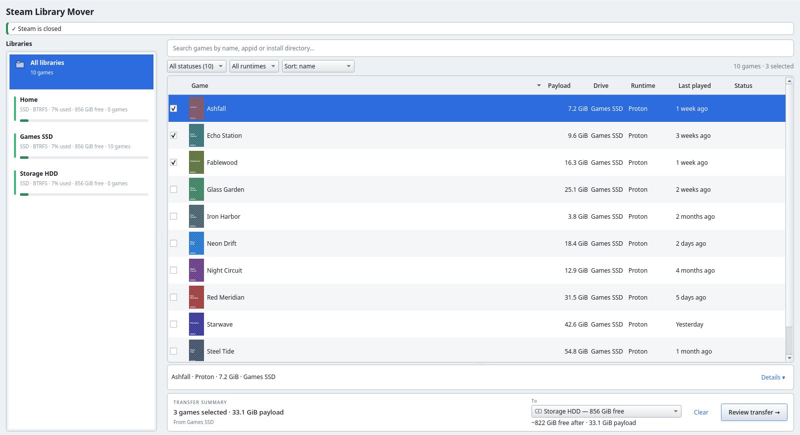
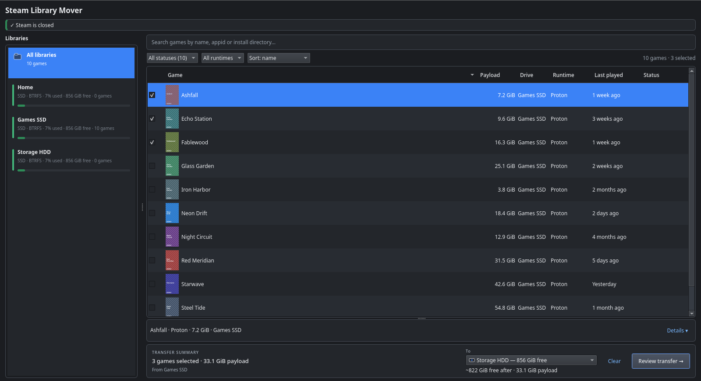
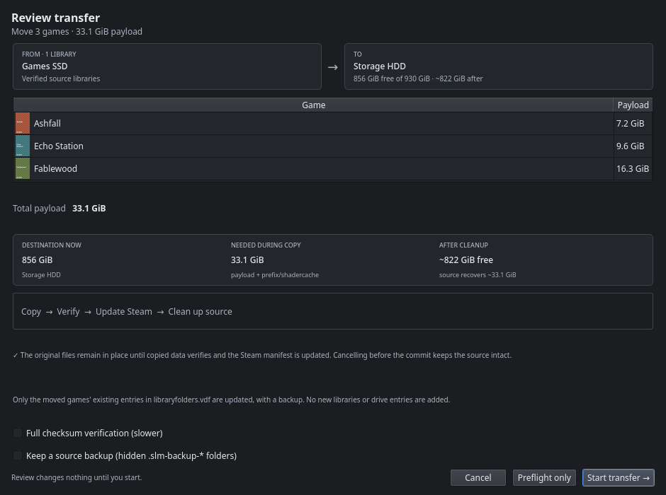
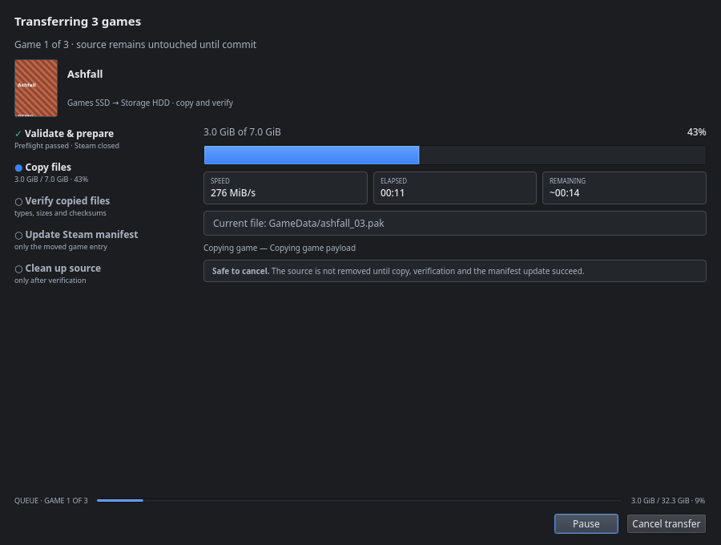

<p align="center">
  
</p>

<h1 align="center">Steam Library Mover</h1>

<p align="center">
  Move installed Steam games between Steam libraries on Linux — without Steam's
  <code>Move install folder</code> operation.
</p>

<p align="center">
  <a href="https://github.com/NasirA1991/steam-library-mover/actions/workflows/ci.yml">
    
  </a>
  <a href="https://github.com/NasirA1991/steam-library-mover/releases">
    
  </a>
  <a href="https://aur.archlinux.org/packages/steam-library-mover">
    
  </a>
  <a href="LICENSE">
    
  </a>
</p>

> **Early alpha.** Steam Library Mover moves real game files. Keep an independent backup of
> irreplaceable saves and game data. Steam must be closed while a move is running.

Steam Library Mover is for Linux gamers who need to move a game between drives or Steam libraries
when Steam's own mover fails — especially Proton games on NTFS drives, shared `compatdata`
symlinks, or libraries that contain filenames Windows filesystems cannot represent.

It reviews the move first, refuses unsafe destinations, journals every operation and keeps the
source intact until the destination has been verified and the Steam manifest has been updated.
The desktop app and CLI use the same move engine.

**Current public release:** v0.1.9 (alpha). See the [release notes](docs/RELEASE_NOTES.md) and
[roadmap decisions](docs/ROADMAP.md).

## Installation

These steps install Steam Library Mover itself. They do not install Steam. See
[Supported Steam installations](#supported-steam-installations) for the Steam variants the app can
manage.

### Arch Linux, CachyOS or EndeavourOS

Install from the AUR with your preferred helper:

| Helper | Command |
| --- | --- |
| `yay` | `yay -S steam-library-mover` |
| `paru` | `paru -S steam-library-mover` |
| `pikaur` | `pikaur -S steam-library-mover` |

Any other AUR helper works too: `<helper> -S steam-library-mover`.

### AppImage

Download the latest portable build:

```bash
curl -LO https://github.com/NasirA1991/steam-library-mover/releases/latest/download/Steam_Library_Mover-x86_64.AppImage
chmod +x Steam_Library_Mover-x86_64.AppImage
./Steam_Library_Mover-x86_64.AppImage
```

### Other distributions

Use the AppImage above, or [build from source](docs/INSTALL.md). A Flatpak build is not currently
offered. See [Installation](docs/INSTALL.md) for dependencies, source builds and uninstall
instructions.

### Uninstall

`sudo pacman -Rns steam-library-mover` for the AUR package, or delete the AppImage. Source-build
uninstall steps are in [Installation](docs/INSTALL.md#uninstall-a-source-install).

After installing, follow [How to move a game](#how-to-move-a-game). The first move should use a
small game and a current backup.

## Requirements

- Linux x86_64 with Steam installed.
- The destination Steam library must already exist and be registered in Steam. Steam Library Mover
  does not create libraries or add drive entries.
- Steam and any Proton/Wine games must be closed before a move. Scanning can run while Steam is
  open; the planner and executor re-check process state.
- The destination must be writable and have enough free space.
- Keep an independent backup of saves and irreplaceable data while the project is in alpha.

## Supported Steam installations

"Flatpak Steam" below refers to how Steam itself is installed. Steam Library Mover has no Flatpak
build; run the AppImage, AUR package or source build natively.

| Installation | Support |
| --- | --- |
| Native Steam | Supported |
| Flatpak Steam | Supported when Steam Library Mover runs natively (AppImage, AUR or source build) |
| Snap Steam | Detected, but moves are not supported |
| Custom Steam installation root | Configurable under **Settings → Steam root override** |

If you have multiple Steam installations, choose the correct one in the Steam installation selector.

**On this page:** [Installation](#installation) · [Requirements](#requirements) ·
[Supported Steam installations](#supported-steam-installations) · [Screenshots](#screenshots) ·
[How to move a game](#how-to-move-a-game) · [Features](#features) · [Safety](#safety) ·
[Limitations](#limitations) · [NTFS libraries](#ntfs-libraries) · [Blocked moves](#blocked-moves) ·
[Command line](#command-line) · [Troubleshooting](#troubleshooting) ·
[Documentation](#documentation) · [Privacy](#privacy) ·
[Contributing and support](#contributing-and-support) · [License](#license)

## Screenshots

<p align="center"><b>Light theme</b></p>

<p align="center">
  
</p>

<p align="center"><b>Dark theme</b></p>

<p align="center">
  
</p>

<p align="center">
  
  &nbsp;
  
</p>

<p align="center"><sub>Screenshots use a demo library, not a real game collection. Review every move
before it starts; unsafe destinations are explained instead of being attempted.</sub></p>

## How to move a game

1. **Close Steam and all Proton/Wine games.**
2. Select the games you want to move using the checkboxes.
3. Choose the destination library in the transfer strip.
4. Click **Review transfer** and check the destination space, source libraries and any warnings.
5. Click **Start transfer**.

The source data is not deleted until the destination has been copied, verified and the Steam
manifest has been updated. If something fails before that point, the source remains usable.

## Features

### Safe game transfers

- **Review before touching files** — see the source, destination, free space, payload size and every
  blocker before a move starts.
- **Full SHA-256 verification by default** — quick mode is an explicit opt-out for speed and does not
  detect same-size corruption.
- **Copy-on-write when available** — reflinks on Btrfs and reflink-enabled XFS make compatible copies
  fast, with a verified normal copy elsewhere.
- **Batch transfers** — queue several games, pause/resume, cancel safely and optionally keep source
  backups.

### Proton and filesystem compatibility

- **Shared Proton prefixes** — understands shared `compatdata` symlinks and refuses to move a prefix
  onto itself, a common cause of Steam's “content file locked” error.
- **NTFS preflight** — checks Windows-invalid names, reserved names, case collisions and
  executable-bit risks before writing to NTFS/exFAT/FAT32.
- **Clear guardrails** — refuses network and unknown filesystems, and treats FUSE `fuseblk` mounts as
  ambiguous instead of silently assuming NTFS. See [NTFS libraries](#ntfs-libraries).

### Recovery and reliability

- **Journaled operations** — interrupted copies can be resumed before the manifest commit; a failed
  verification is repaired once automatically.
- **Safe rollback** — unfinished operations can be rolled back while the source manifest still
  exists. See [Safety](#safety) and [Recovery](docs/CLI.md#recover).
- **Single-writer protection** — a machine-wide lock prevents overlapping GUI/CLI moves; finished
  journals are pruned while recoverable ones are retained.
- **Monitored during the copy** — if Steam, a game or a Proton/Wine process starts mid-move, the
  operation stops before the manifest commit.

### Library health and maintenance

- **Library Health** — finds stale lock files, orphaned data, duplicate appids and broken
  `compatdata` links; quarantine renames files and never deletes them.
- **NTFS Doctor** — checks or creates the recommended shared `compatdata` symlink and refuses to
  replace a non-empty prefix directory. See [docs/NTFS.md](docs/NTFS.md).

### Desktop integration and automation

- **Desktop integration** — notifications, optional Start Steam after a move, sleep inhibition,
  Light/Dark/System themes and quick SteamDB/ProtonDB links.
- **Command line** — the same move engine for scripting and diagnostics; see the
  [CLI reference](docs/CLI.md).

## Safety

- Steam must be completely closed while moving a game.
- The destination library must already be registered in Steam. A move updates only the moved game's
  existing Steam metadata, with a backup; it does not add libraries or drive entries.
- Network and unknown filesystem types are refused. FUSE `fuseblk` mounts are ambiguous and carry
  an explicit warning rather than being silently treated as NTFS.
- Full SHA-256 verification is on by default. Quick verification is an explicit opt-out that checks
  paths and sizes only.
- Snap Steam is detected but unsupported.
- Native Linux games on NTFS/exFAT are not officially supported by Steam. Proton games usually work,
  but executable permissions cannot be preserved on those filesystems.

See [docs/SAFETY.md](docs/SAFETY.md) for the transaction order, rollback rules and full safety model.

## Limitations

- This is alpha software. Keep backups, and test the first move with a small game.
- Resume is supported only for operations interrupted **before** the Steam manifest commit. There is
  no one-click undo after a completed move.
- Steam Library Mover does not create or register Steam libraries, adopt unregistered games, or
  modify cloud saves.
- xattrs/ACLs and sparse extents are not preserved. Symlinks, modes and mtimes are preserved where
  the destination supports them.
- A Flatpak build is not currently offered. Snap Steam is detected but not supported for moves.

## NTFS libraries

Steam does not officially support game libraries on NTFS. If your games are on NTFS, keep the real
Proton prefixes on a Linux filesystem and link that directory into the NTFS library. The link target
must also be on a Linux filesystem; pointing it at another NTFS/exFAT/FAT32 directory does not solve
the problem.

Do not create the link until you have checked the destination path. A bare `ln -s` can create a link
*inside* an existing directory, which is not what you want:

```bash
shared="$HOME/.local/share/Steam/steamapps/compatdata"
library="/mnt/games/SteamLibrary/steamapps/compatdata"

if [ -L "$library" ]; then
    if [ "$(readlink -f -- "$library")" = "$(readlink -f -- "$shared")" ]; then
        echo "Already configured."
    else
        echo "Refusing: $library points somewhere else; leaving it unchanged." >&2
    fi
elif [ -e "$library" ]; then
    echo "Refusing: $library already exists; leaving it unchanged." >&2
    echo "If it is empty, inspect it and remove it with rmdir, then rerun." >&2
    echo "If it contains prefixes, migrate them first; never delete a non-empty directory." >&2
else
    mkdir -p -- "$shared"
    ln -s -- "$shared" "$library"
fi
```

- **Empty real directory:** confirm it is empty with
  `find "$library" -mindepth 1 -maxdepth 1 -print -quit` (no output means empty), then remove it with
  `rmdir -- "$library"` and rerun the block. Do not use `rm -rf`.
- **Non-empty directory:** stop. Do not delete it. Existing Proton prefixes must be migrated first,
  with Steam closed and a backup. The **NTFS Doctor** refuses to replace a non-empty prefix directory.
- **Different symlink:** do not overwrite it. Decide whether it is correct before changing anything.

The **NTFS Doctor** can check the resulting layout. See [docs/NTFS.md](docs/NTFS.md) for mount
options, permissions, prefix migration and troubleshooting.

## Blocked moves

A game may be blocked for a real reason, for example:

- the source or destination library is mounted read-only;
- the destination is NTFS and the game contains filenames that differ only by case;
- the destination does not have enough free space;
- Steam or a Proton/Wine game is still running;
- the game is updating or its payload is missing.

The review dialog names the blocker and offers **Why blocked?** with the relevant paths and
guidance. A blocked move is not attempted.

## Command line

```bash
# List installed games and libraries
steam-library-mover-cli list

# Preview a move; changes nothing
steam-library-mover-cli plan --appid 346010 --to /mnt/games/SteamLibrary

# Move after reviewing the plan
steam-library-mover-cli move --appid 346010 --to /mnt/games/SteamLibrary --yes

# Check library health
steam-library-mover-cli health

# Inspect, resume or roll back an interrupted operation
steam-library-mover-cli recover --list
steam-library-mover-cli recover --resume <operation-id>
steam-library-mover-cli recover --rollback <operation-id>
```

See the [CLI reference](docs/CLI.md) for all commands, options, exit codes and JSON output.
`steam-library-mover-cli --help` also prints the global option list.

## Troubleshooting

| Problem | What to do |
| --- | --- |
| Steam's own mover fails with “content file locked” | Use Steam Library Mover; it handles shared Proton prefixes without moving a prefix onto itself. |
| A library is read-only | Check `findmnt -T <library path>` and remount it read-write with the correct permissions. |
| Move blocked by an NTFS case collision | Use a case-sensitive Linux filesystem, or resolve the conflicting game file with a backup. The app does not modify game files automatically. |
| Game is not listed | Click **Rescan**, check the selected Steam installation, or set a custom Steam root in Settings. |
| Move interrupted or verification failed | Open **Recovery** and resume the operation, or run `steam-library-mover-cli recover --list`. See [Recovery](docs/CLI.md#recover). |
| Need the operation log | Open **Recovery → View log**, or read `~/.local/state/steam-library-mover/operations/<operation-id>/log.txt`. |
| The AUR build still looks old | Check `command -v steam-library-mover`. An old copy in `/usr/local/bin` can shadow `/usr/bin/steam-library-mover`. |
| AppImage will not start | Make it executable and try `APPIMAGE_EXTRACT_AND_RUN=1 ./Steam_Library_Mover-x86_64.AppImage`. |

If a move is blocked and you are unsure why, the **Why blocked?** button in the review dialog
includes the exact paths and guidance. If the problem is not explained there,
[open an issue](https://github.com/NasirA1991/steam-library-mover/issues).

## Documentation

| Document | Use it for |
| --- | --- |
| [Installation](docs/INSTALL.md) | AUR, AppImage, source build, dependencies and uninstall |
| [CLI reference](docs/CLI.md) | Commands, options, exit codes, JSON and recovery |
| [Safety model](docs/SAFETY.md) | Transaction order, journals, rollback and deletion rules |
| [NTFS libraries](docs/NTFS.md) | Proton prefixes, mount options and NTFS Doctor |
| [Architecture](docs/ARCHITECTURE.md) | Code layout, data flow and recovery design |
| [Testing](docs/TESTING.md) | Automated tests and manual acceptance checks |
| [Packaging](docs/PACKAGING.md) | Release builds, AUR, AppImage, Flatpak and supply chain |
| [Roadmap](docs/ROADMAP.md) | Current priorities and deliberate non-goals |
| [Release notes](docs/RELEASE_NOTES.md) | Changes in the current release |
| [Contributing](CONTRIBUTING.md) | Development setup, tests and pull-request expectations |
| [Security policy](SECURITY.md) | Private reporting of destructive or security-sensitive bugs |

## Privacy

Steam Library Mover does not include telemetry or require an account. By default it fetches game
cover art from Valve's public Steam CDN; that request includes the game's appid and your IP address.
Disable artwork in **Settings** or set `SLM_DISABLE_ARTWORK=1` to keep the app fully local.

## Contributing and support

Bug reports and feature requests are welcome on the
[issue tracker](https://github.com/NasirA1991/steam-library-mover/issues). Read
[CONTRIBUTING.md](CONTRIBUTING.md) before sending a pull request. Report security-sensitive issues
privately as described in [SECURITY.md](SECURITY.md).

## License

GPL-3.0-or-later. Not affiliated with Valve Corporation. Steam is a trademark of Valve Corporation.
